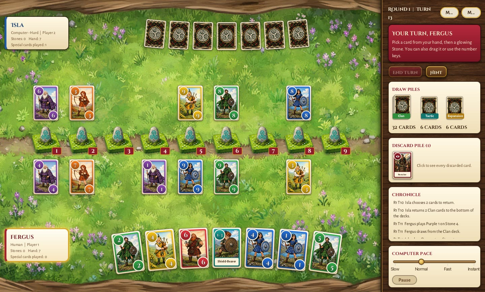
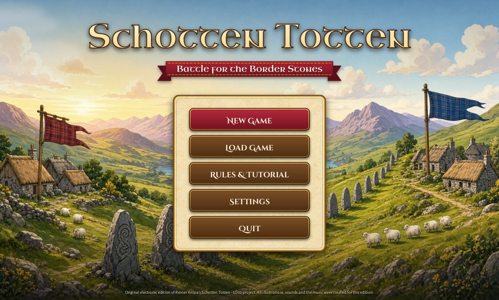
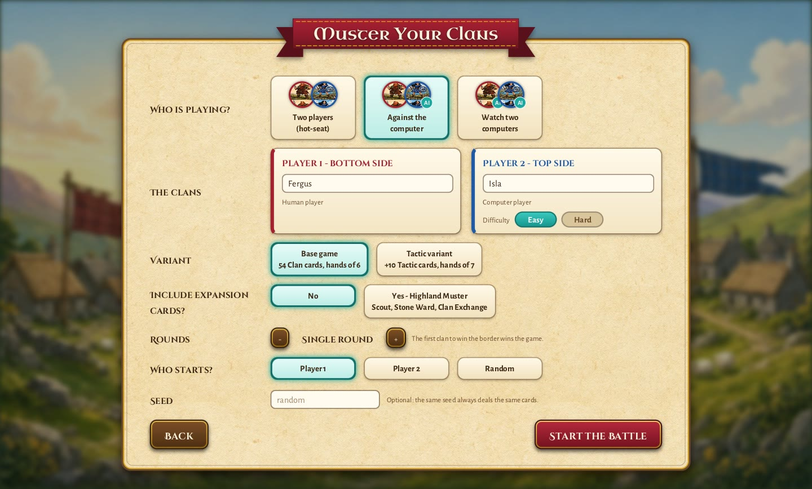
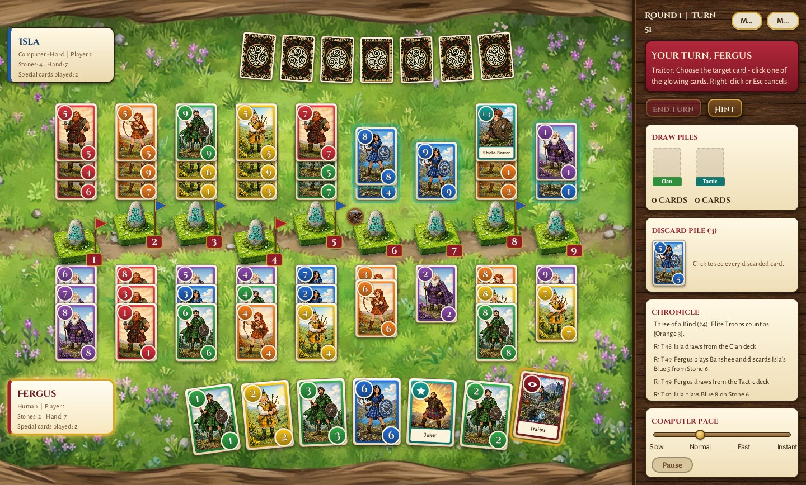
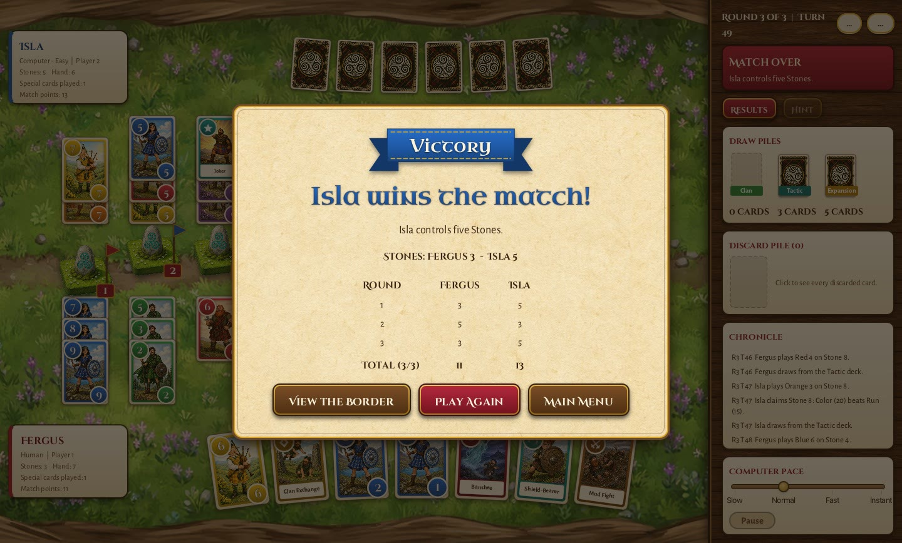

# Schotten Totten

[](https://openjdk.org/projects/jdk/21/)
[](https://openjfx.io/)
[](https://maven.apache.org/)
[](docs/test-report.md)
[](docs/test-report.md)

An illustrated Scottish strategy card game built with Java 21, JavaFX and MVC, featuring intelligent AI, tactical gameplay and a complete desktop interface.

[](docs/media/screenshots/gameplay-board.jpg)

## About the game

Two clans contest a line of nine border Stones. Each turn you place a card into a three-card formation, then draw. Stronger combinations — Colour-Run, Three of a Kind, Colour, Run, or Sum — claim Stones. Win with three adjacent Stones or five anywhere along the border.

This desktop edition brings the full board, animated cards and a side chronicle into a polished JavaFX window, with optional Tactic cards and an original Highland Muster expansion.

## Key features

- Human vs Human (hot-seat), Human vs AI, and AI vs AI
- Easy and Hard computer players (Strategy pattern)
- All ten official Tactic cards, plus three original expansion cards
- Save and resume mid-match (versioned JSON)
- Interactive JavaFX board with drag-and-drop, hints and keyboard shortcuts
- Shared live session: GUI and CLI control the same game (MVC)
- Preferences via a Singleton `GameSettings`

## Screenshots

| Main menu | Setup | Board |
| :---: | :---: | :---: |
| [](docs/media/screenshots/main-menu.jpg) | [](docs/media/screenshots/game-setup.jpg) | [](docs/media/screenshots/gameplay-board.jpg) |

| Tactic play | Victory |
| :---: | :---: |
| [](docs/media/screenshots/tactic-cards.jpg) | [](docs/media/screenshots/victory-screen.jpg) |

## Gameplay demo

[](docs/media/schotten-totten-demo.mp4)

About 48 seconds of the real JavaFX application: main menu, set-up, card play, a Traitor tactic interaction, and the victory screen.

## Quick start

**Requires:** JDK 21 and Maven 3.9+

```bash
# macOS (Homebrew)
brew install openjdk@21 maven
export JAVA_HOME=/opt/homebrew/opt/openjdk@21/libexec/openjdk.jdk/Contents/Home

mvn package
mvn javafx:run          # graphical interface
mvn exec:java           # command line
mvn test                # automated tests
```

Shared GUI + CLI on one live game:

```bash
mvn javafx:run -Djavafx.args=--with-cli
```

## Architecture

The `engine`, `rules`, `model` and `cards` packages implement the game with no JavaFX dependency. Views (`view`, `cli`) submit actions through a shared `GameSession` / `SessionHub` controller, so both UIs stay in sync. Virtual players plug in via `PlayerStrategy` (Easy / Hard). Application preferences live in the `GameSettings` Singleton; per-match rules travel in `GameConfiguration`.

## Documentation

- [UML diagrams](docs/uml/)
- [Project status](docs/project-status.md)
- [Test report](docs/test-report.md)
- [Requirements traceability](docs/requirements-traceability.md)
- [Asset provenance](docs/assets.md)

---

Developed by **Preeti Gorial**  
LO02 — Java Programming  
Université de Technologie de Troyes (UTT), France  
Academic year 2026–2027
