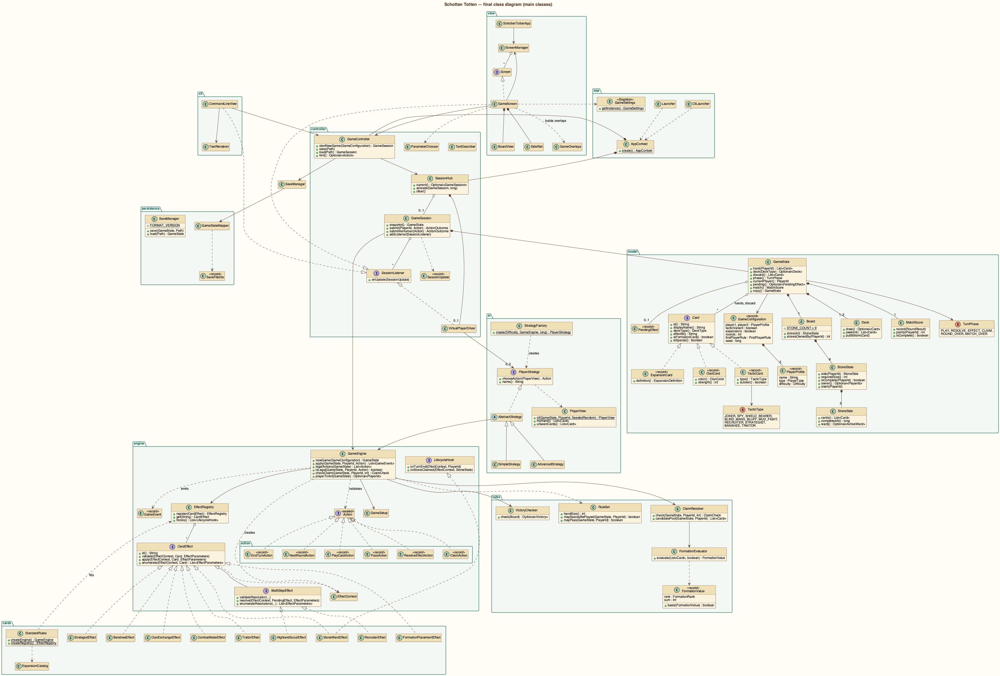

# Design Evolution: initial design versus final implementation

## 1. About the initial (Phase 1) diagram

The specification asks for the final class diagram to be presented next to the initial Phase 1 diagram, with every change justified [SPEC p.3].

**No Phase 1 diagram was available to us.** The project folder contains only the two reference PDFs, and the Phase 1 slides were not supplied. We have not reconstructed or invented one: a diagram drawn afterwards would not show what was really designed at the start.

As a stand-in, this document compares the final code with the **initial design brief**: the list of suggested components that the project started from (GameEngine, GameSession, GameState, Player, HumanPlayer, VirtualPlayer, Board, Stone, Formation, Card, ClanCard, TacticCard, ExpansionCard, Deck, RuleSet, FormationEvaluator, FormationRank, GameConfiguration, PlayerStrategy, SimpleStrategy, AdvancedStrategy, CardEffect, SaveManager, GameController, GameEventPublisher). If the team's Phase 1 diagram is found, it should be added as `docs/uml/initial-class-diagram.*` and section 3 completed against it.

The final diagrams are in `docs/uml/`:

| Diagram | Files |
|---|---|
| Final class diagram (main classes of every package) | `class-diagram.puml`, `.png`, `.svg` |
| Singleton: `GameSettings` | `singleton-gamesettings.*` |
| Strategy: virtual players | `strategy-ai.*` |
| Sequence: a normal turn | `sequence-normal-turn.*` |
| Sequence: Tactic card effects (Traitor, Recruiter) | `sequence-tactic-effect.*` |
| MVC overview with two competing views | `mvc.*` |

## 2. Final architecture in brief

- **Model.** `model` holds data (cards, decks, Stones, `GameState`). `rules` holds pure rule logic (formation strength, claims, victory, variant limits). `engine` is the turn state machine and the effect system, and `cards` holds one effect class per card behaviour. None of these packages imports JavaFX, the command line or the preferences.
- **Controller.** `GameSession` owns one live game. It validates every action on a copy, commits it only if the engine accepts it, then notifies its listeners. `SessionHub` holds the active session and the virtual-player driver. `GameController` is the facade the views use.
- **Views.** `view` (JavaFX) and `cli` (text) both listen to the same session and submit the same `Action` objects, so either can play the same game.
- **Services.** `ai` (Strategy pattern), `persistence` (versioned JSON) and `app` (entry points, wiring, `GameSettings` Singleton).

## 3. Changes from the initial component list, with justification

| Initial component | Final design | Why it changed |
|---|---|---|
| `Player`, `HumanPlayer`, `VirtualPlayer` | `PlayerId` (enum P1/P2), `PlayerProfile` (record: name, `PlayerType`, `Difficulty`), hands in `GameState`; virtual behaviour in `PlayerStrategy` + `VirtualPlayerDriver` | A player class hierarchy would have mixed game data (hand) with decision logic and UI control. With an identifier plus a profile, the state is a plain copyable value. Deciding is the strategy's job (Strategy pattern), and *when* to decide is the driver's job. Human players need no class at all: the views submit their actions. Saving, copying for AI simulation and hot-seat play became simpler. |
| `Stone` | `StoneState` (one Stone: two sides, Combat Modes, owner) and `StoneSide` (cards, completion order, Stone Ward) | Completion order and protection belong to one side, not to the Stone. Splitting them keeps `StoneState` small and makes tie-breaking (`StoneSide.completedAt`) explicit. |
| `Formation` | `FormationValue` (record: rank, sum, chosen Elite identities) computed by `FormationEvaluator` | A formation is not stored; it is derived from the cards on a side. Storing it would duplicate state that cards such as Strategist, Banshee or Traitor can invalidate. A computed immutable value cannot go stale. |
| `FormationRank` | Kept as an enum | Unchanged. |
| `GameEngine` | Kept as the single entry point: `apply(state, actor, action)`, `legalActions(state)` | It now also knows nothing about specific cards (see `CardEffect`). |
| *(none)* | `engine.action.Action`, a sealed interface with six records: `PlayCardAction`, `PassAction`, `ClaimAction`, `ResolveEffectAction`, `EndTurnAction`, `NextRoundAction` | The Command pattern gives the GUI, the CLI, the AI, the hint and the tests one vocabulary. The sealed hierarchy lets the engine switch over every action type with compile-time exhaustiveness. Actions are also what the session history records. |
| `CardEffect` | `CardEffect` + `MultiStepEffect` (second decision, such as Recruiter or Highland Scout) + `LifecycleHook` (end of turn, Stone claimed, such as Stone Ward) in an `EffectRegistry` | The initial idea had one effect interface. Cards that need a second decision, or that last several turns, would have forced card-specific code into the engine. The extra interfaces keep the engine closed for modification: the three expansion cards were added without changing `GameEngine` (Open/Closed principle). |
| `Card`, `ClanCard`, `TacticCard`, `ExpansionCard` | Kept; immutable records behind the `Card` interface, with a stable `id()` | Immutable values with stable identifiers make saves, events and commands refer to cards safely. |
| `Deck` | Kept | Adds `peek`, `reorderTop` and `putBottom` for Highland Scout and Recruiter. |
| `RuleSet` | Kept, built from `GameConfiguration` | It holds the variant-dependent limits (hand size, decks, special-card counter, passing), so a rule change is local. |
| `GameConfiguration` | Kept as an immutable record | Per-game rules travel explicitly to the engine, which keeps the Singleton out of the rules (see section 4). |
| *(none)* | `ClaimResolver`, `ClaimCheck`, `VictoryChecker` | Claim proof is the most delicate rule (exhaustive search over public information). It deserved its own tested class instead of living in the engine. |
| *(none)* | `PlayerView` | Guarantees that strategies never see hidden information: the opponent's hand and the deck order are replaced by a random redistribution of the unseen cards. |
| `GameSession` | Kept, with atomic copy-then-commit, version numbers and listeners | Needed so that two views and the AI thread can act on one game without races ("two competing views", SPEC p.2). |
| `GameEventPublisher` | `SessionListener` + `SessionUpdate` (snapshot and events) inside `GameSession`; `SessionHub` notifies the views when the active session changes | A separate publisher class would only have forwarded calls. Publishing from the session guarantees that listeners only ever see committed states. |
| `GameController` | Kept as a facade (new game, save, load, resume, hint), plus `ParameterChooser` and `TextDescriber` | The two helpers let both views ask for card targets field by field and describe moves in the same words, instead of duplicating that logic in each view. |
| `SaveManager` | Kept, with `GameStateMapper` and `SaveFileDto` | The state is mapped to plain records written with Jackson, never with Java serialisation. Loading re-validates every card. |
| `PlayerStrategy`, `SimpleStrategy`, `AdvancedStrategy` | Kept, plus `AbstractStrategy` (template for play / resolve / draw) and `StrategyFactory` | The template removes duplicated claim and turn-ending logic from both strategies. |
| *(none)* | `GameSettings` (Singleton), `AppContext` | See section 4. |

## 4. Design patterns and trade-offs

**Strategy (virtual players).** `PlayerStrategy.chooseAction(PlayerView)` is the only thing the rest of the program knows about a virtual player. Difficulty is a choice of strategy, made by `StrategyFactory`. A strategy can be swapped without touching the engine or the views, and it is tested by simulating games with fixed seeds.

**Singleton (`GameSettings`).** Sound, music, volume, reduced motion, computer pace, hints and the default difficulty are preferences of the person at the computer, stored in one file (`~/.schotten-totten/settings.json`). Every screen must see the same values, so a single instance is justified. It is created lazily and safely with the initialisation-on-demand holder idiom.

The trade-offs, and how they are contained:

- **Global state makes testing harder.** The engine, the rules and the session never read `GameSettings`: game rules come from `GameConfiguration`. Tests redirect the settings file with the `schotten.settings` system property.
- **It must not prevent several games.** Nothing about a game is stored in the Singleton, so any number of `GameSession`s can exist (the tests run many at once).
- **Hidden dependencies.** Only the application wiring (`AppContext`, for the computer pace) and view classes read it. The Singleton diagram lists each client.

**Observer.** `SessionListener` lets the GUI, the command line and the virtual-player driver react to the same committed changes.

**Command.** `Action` records, validated by one engine.

**Template method.** `AbstractStrategy.chooseAction` fixes the structure of a decision; subclasses choose the play, the resolution and the draw.

**Registry / plug-in.** `EffectRegistry` maps an effect identifier to its behaviour.

## 5. What could still evolve

- The command line's `speed` command uses its own copy of the four pace values. This avoids a dependency from `cli` to `app`, but the values are duplicated.
- Expansion cards are registered in code (`ExpansionCatalog`). Loading them from data files would require a scripting or rule language, which is out of scope.
